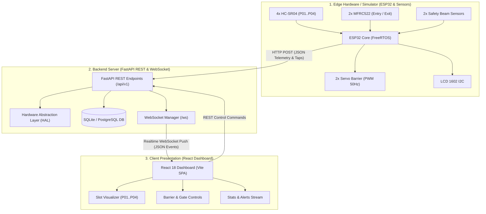
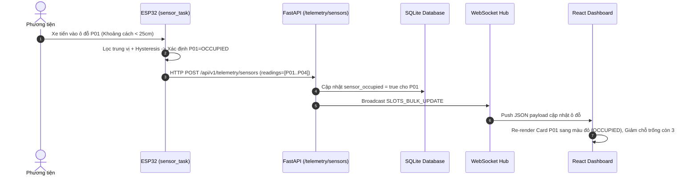
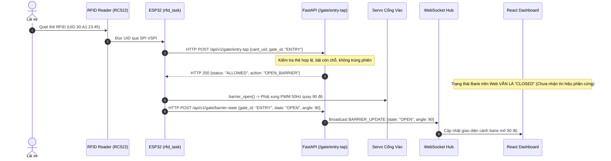
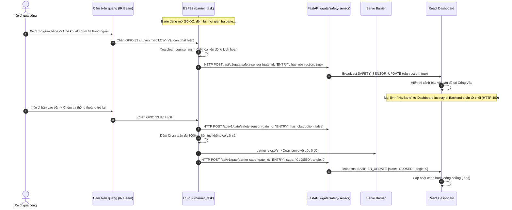

# KIẾN TRÚC LUỒNG DỮ LIỆU THỜI GIAN THỰC — ESP32 ↔ BACKEND ↔ FRONTEND
## ESP32 FIRMWARE ↔ FASTAPI REST/WS ↔ REACT WEB DASHBOARD

**Dự án:** Smart Parking System — ESP32 + RFID + Camera AI + IoT  
**Mục tiêu tài liệu:** Đặc tả chi tiết kiến trúc luồng dữ liệu thời gian thực, mô hình phân tách quyết định xác thực và xác nhận cơ cấu chấp hành (Decoupled Actuator Telemetry), cùng cơ chế khóa liên động an toàn (Safety Interlock).

---

## 1. Sơ đồ Kiến trúc Tổng quan (System Topology)

---

## 2. Luồng Dữ liệu Đo đạc Cảm biến Siêu âm (Ultrasonic Telemetry Flow)

ESP32 đọc khoảng cách định kỳ qua tác vụ `sensor_task` (Core 1), lưu snapshot vào Mutex, và `network_task` (Core 0) gửi dữ liệu lên Backend mỗi 2 giây.

---

## 3. Luồng Quẹt thẻ & Phân tách Quyết định Xác thực (Decoupled RFID Flow)

Nguyên tắc an toàn: Backend chỉ đưa ra quyết định **cho phép/từ chối**. Trạng thái cánh barie trên Dashboard chỉ được hiển thị là **OPEN** khi ESP32 thực tế đã điều khiển servo và gửi telemetry phản hồi.

---

## 4. Luồng Khóa Liên động An toàn (Safety Interlock Sequence)

Cảm biến quang an toàn (Safety Beam / Active LOW) ngăn chặn barie hạ đè vào xe. Khi phát hiện vật cản, bộ đếm đóng 3 giây bị hủy bỏ và giữ barie mở cho đến khi hoàn toàn thông thoáng liên tục trong 3000ms.

