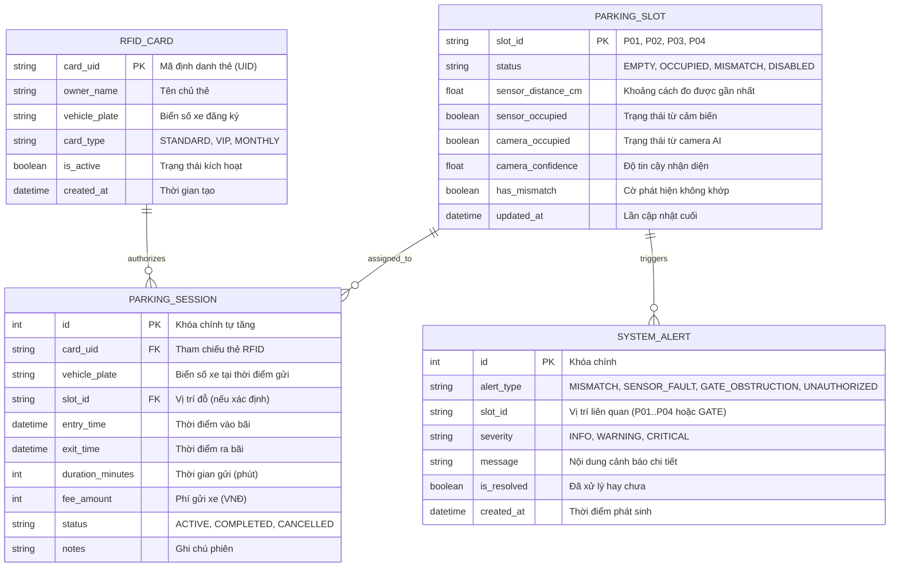

# THIẾT KẾ CƠ SỞ DỮ LIỆU — DATABASE DESIGN

## 1. Mô hình quan hệ thực thể (ERD)

Hệ thống sử dụng SQLite (giai đoạn Lab/Phát triển) kết hợp SQLAlchemy ORM. Thiết kế tương thích hoàn toàn để chuyển đổi sang PostgreSQL hoặc MySQL khi lên production.

---

## 2. Chi tiết các bảng (Table Schema)

### 2.1. Bảng `rfid_cards`
| Tên cột | Kiểu dữ liệu | Ràng buộc | Mô tả |
| :--- | :--- | :--- | :--- |
| `card_uid` | VARCHAR(32) | PRIMARY KEY | Mã UID của thẻ RFID (VD: `TAG-8F2B10`) |
| `owner_name` | VARCHAR(100) | NOT NULL | Tên chủ phương tiện |
| `vehicle_plate` | VARCHAR(20) | NOT NULL, INDEX | Biển kiểm soát xe |
| `card_type` | VARCHAR(20) | DEFAULT 'STANDARD' | Loại thẻ: `STANDARD`, `VIP`, `STAFF` |
| `is_active` | BOOLEAN | DEFAULT 1 | 1: Đang hoạt động, 0: Đã khoá |
| `created_at` | DATETIME | DEFAULT CURRENT_TIMESTAMP | Thời điểm cấp thẻ |

### 2.2. Bảng `parking_slots`
| Tên cột | Kiểu dữ liệu | Ràng buộc | Mô tả |
| :--- | :--- | :--- | :--- |
| `slot_id` | VARCHAR(10) | PRIMARY KEY | Định danh vị trí (`P01`, `P02`, `P03`, `P04`) |
| `status` | VARCHAR(20) | DEFAULT 'EMPTY' | `EMPTY`, `OCCUPIED`, `MISMATCH`, `DISABLED` |
| `sensor_distance_cm` | FLOAT | DEFAULT 100.0 | Khoảng cách đo được từ cảm biến siêu âm |
| `sensor_occupied` | BOOLEAN | DEFAULT 0 | 1: Có xe theo cảm biến |
| `camera_occupied` | BOOLEAN | DEFAULT 0 | 1: Có xe theo camera AI |
| `camera_confidence` | FLOAT | DEFAULT 1.0 | Độ tin cậy nhận diện (0.0 - 1.0) |
| `has_mismatch` | BOOLEAN | DEFAULT 0 | Cờ báo không khớp giữa cảm biến và camera |
| `updated_at` | DATETIME | ON UPDATE CURRENT_TIMESTAMP | Thời điểm đồng bộ cuối cùng |

### 2.3. Bảng `parking_sessions`
| Tên cột | Kiểu dữ liệu | Ràng buộc | Mô tả |
| :--- | :--- | :--- | :--- |
| `id` | INTEGER | PRIMARY KEY AUTOINCREMENT | Mã định danh phiên gửi xe |
| `card_uid` | VARCHAR(32) | FOREIGN KEY -> `rfid_cards.card_uid` | Mã thẻ gửi xe |
| `vehicle_plate` | VARCHAR(20) | NULLABLE | Biển số xe ghi nhận |
| `slot_id` | VARCHAR(10) | NULLABLE, FK -> `parking_slots.slot_id` | Ô đỗ xe |
| `entry_time` | DATETIME | NOT NULL | Giờ xe vào bãi |
| `exit_time` | DATETIME | NULLABLE | Giờ xe ra bãi (NULL nếu đang gửi) |
| `duration_minutes` | INTEGER | DEFAULT 0 | Tổng thời gian đỗ tính theo phút |
| `fee_amount` | INTEGER | DEFAULT 0 | Số tiền thanh toán (VNĐ) |
| `status` | VARCHAR(20) | DEFAULT 'ACTIVE', INDEX | `ACTIVE`, `COMPLETED`, `CANCELLED` |
| `notes` | TEXT | NULLABLE | Ghi chú bất thường nếu có |

### 2.4. Bảng `system_alerts`
| Tên cột | Kiểu dữ liệu | Ràng buộc | Mô tả |
| :--- | :--- | :--- | :--- |
| `id` | INTEGER | PRIMARY KEY AUTOINCREMENT | Mã cảnh báo |
| `alert_type` | VARCHAR(30) | NOT NULL | Phân loại cảnh báo |
| `slot_id` | VARCHAR(10) | NULLABLE | Vị trí ô đỗ phát sinh |
| `severity` | VARCHAR(20) | DEFAULT 'WARNING' | `INFO`, `WARNING`, `CRITICAL` |
| `message` | TEXT | NOT NULL | Chi tiết sự kiện |
| `is_resolved` | BOOLEAN | DEFAULT 0 | Trạng thái đã xử lý |
| `created_at` | DATETIME | DEFAULT CURRENT_TIMESTAMP | Thời điểm ghi nhận |
