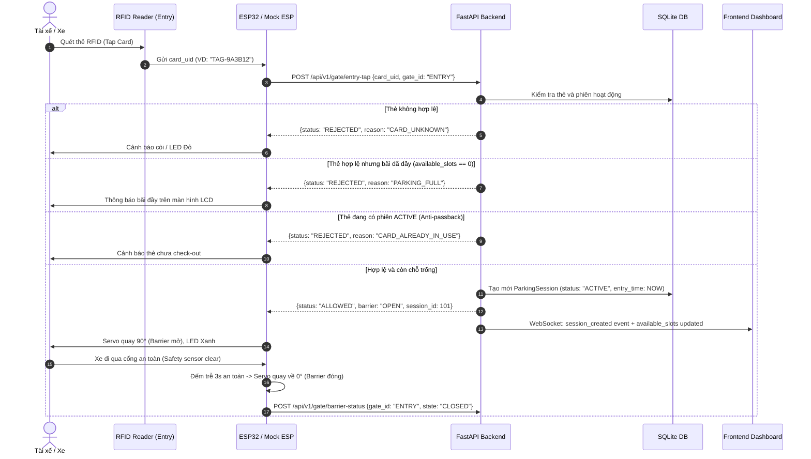
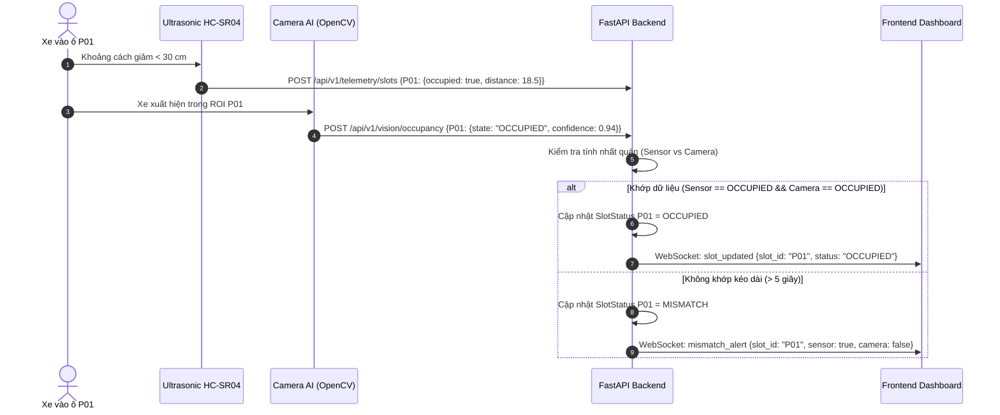
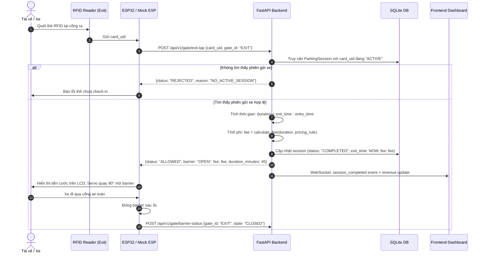

# QUY TRÌNH HOẠT ĐỘNG HỆ THỐNG — SYSTEM FLOW

## 1. Quy trình xe vào bãi (Vehicle Entry Flow)

Quy trình diễn ra khi xe tiến đến cổng vào và tài xế quét thẻ RFID:

---

## 2. Quy trình xe đỗ vào ô và đồng bộ trạng thái (Slot Occupancy Flow)

Khi xe di chuyển vào vị trí đỗ P01 - P04:

---

## 3. Quy trình xe ra bãi và tính phí (Vehicle Exit Flow)

Khi tài xế rời ô đỗ và tiến đến cổng ra:

---

## 4. Xử lý các trường hợp ngoại lệ (Edge Cases)

1. **Bãi đầy (Available slots = 0):**
   - Đèn báo cổng chuyển đỏ.
   - Thẻ quét bị từ chối với lý do rõ ràng.
   - Giao diện Dashboard hiển thị cảnh báo bãi đầy.
2. **Kẹt barrier (Vật cản trong khi đang hạ):**
   - Cảm biến hồng ngoại/khoảng cách phát hiện vật cản tại cổng -> Lập tức đảo chiều Servo mở lại 90°.
   - Gửi cảnh báo `BARRIER_OBSTRUCTION_DETECTED` về Backend.
3. **Mất kết nối ESP32 hoặc Camera AI:**
   - Backend chạy định kỳ kiểm tra Heartbeat (mỗi 10 giây).
   - Nếu quá 15 giây không nhận telemetry -> chuyển trạng thái thiết bị sang `OFFLINE` trên Dashboard.
4. **Mất nguồn hoặc reset ESP32 giữa chừng:**
   - ESP32 là stateless đối với phiên gửi xe; toàn bộ phiên được lưu trữ an toàn trong Database của Backend. Khi ESP32 khởi động lại, nó tiếp tục đọc cảm biến bình thường mà không làm mất phiên xe.
