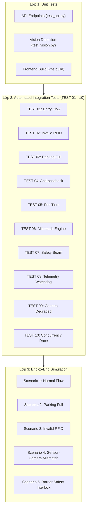

# KẾ HOẠCH KIỂM THỬ HỆ THỐNG (TEST PLAN)
## SMART PARKING SYSTEM — GIAI ĐOẠN 2: SIMULATION & INTEGRATION TESTING

---

## 1. Mục Tiêu & Phạm Vi (Objectives & Scope)

### 1.1. Mục Tiêu
- Đảm bảo toàn bộ hệ thống đỗ xe thông minh **SMART PARKING SYSTEM** (ESP32 + RFID + Ultrasonic + OpenCV Camera AI + FastAPI + React) vận hành ổn định, chính xác 100% logic nghiệp vụ trong chế độ **FULL SOFTWARE SIMULATION** khi chưa có phần cứng vật lý.
- Kiểm thử các ca biên (edge cases), xung đột đồng thời (race conditions), kiểm soát an toàn barrier, phát hiện sai lệch cảm biến và xử lý mất tín hiệu.
- Đảm bảo tính toàn vẹn của dữ liệu trong cơ sở dữ liệu SQLite và sự đồng bộ thời gian thực qua WebSocket đến Web Dashboard.

### 1.2. Phạm Vi Kiểm Thử (Scope)
| Module | Thành Phần Kiểm Thử | Chế Độ Thực Hiện |
| :--- | :--- | :--- |
| **Backend** | FastAPI REST API, WebSocket Manager, ParkingService, HardwareAdapter | Simulation Mock + TestClient |
| **Vision** | OpenCV Heuristic Occupancy Detector, 4 ROI Manager, Synthetic Stream | Video / Synthetic Frames |
| **Simulation** | Mock ESP32, Mock RFID, Mock Barrier, 5 Scenarios Runner | Python Async/Subprocess |
| **Frontend** | React 18, Vite, WebSocket Lifecycle, Responsive Dashboard | Build verification & Mock Endpoints |
| **Firmware** | FreeRTOS State Machine, HAL Abstraction, Network Client | C Static Analysis & Code Audit |

---

## 2. Chiến Lược Kiểm Thử (Testing Strategy)

Hệ thống áp dụng mô hình kim tự tháp kiểm thử 3 lớp:
1. **Unit Testing:** Kiểm thử độc lập từng hàm nghiệp vụ, detector xử lý ảnh và các endpoint REST.
2. **Integration Testing (10 Automated Scenarios):** Kiểm thử quy trình tương tác đa module, khóa đồng bộ, an toàn barrier và cơ chế tự phục hồi cảnh báo.
3. **End-to-End Simulation Testing:** Giả lập toàn bộ luồng xe di chuyển, quẹt thẻ, đỗ xe và tính phí với các công cụ CLI mô phỏng.

---

## 3. Ma Trận Ca Kiểm Thử (Test Case Matrix)

### 3.1. 10 Ca Kiểm Thử Tích Hợp Tự Động (Automated Integration Tests)

| Mã Ca | Tên Ca Kiểm Thử | Điều Kiện Đầu Vào | Hành Động | Kết Quả Mong Đợi | Trạng Thái |
| :--- | :--- | :--- | :--- | :--- | :--- |
| **TEST-01** | `test_01_normal_entry_flow` | 4 ô đỗ trống, barrier đóng. | Quẹt thẻ hợp lệ `RFID-DEMO-01`, xe qua cổng, đỗ vào P01. | Phiên `ACTIVE`, barrier mở -> đóng, P01 `OCCUPIED`, còn 3 chỗ trống. | **PASS** |
| **TEST-02** | `test_02_invalid_rfid` | Cổng vào đóng. | Quẹt thẻ lạ `RFID-ROGUE-9999`. | Từ chối `CARD_UNKNOWN`, barrier đóng, không tạo phiên gửi xe. | **PASS** |
| **TEST-03** | `test_03_parking_full` | 4 xe đã check-in (ACTIVE). | Xe thứ 5 (`RFID-DEMO-05`) quẹt thẻ vào. | Từ chối `PARKING_FULL`, ghi cảnh báo hệ thống, barrier đóng. | **PASS** |
| **TEST-04** | `test_04_anti_passback` | Thẻ `RFID-DEMO-01` đang có phiên `ACTIVE`. | Quẹt lại thẻ `RFID-DEMO-01` tại cổng vào. | Từ chối `CARD_ALREADY_IN_USE`, không tạo thêm phiên trùng lặp. | **PASS** |
| **TEST-05** | `test_05_exit_and_fee_calculation` | 3 phiên gửi xe: 10 phút, 40 phút, 130 phút. | Lần lượt quẹt thẻ tại cổng ra. | Phí tương ứng: 0 VNĐ, 10.000 VNĐ, 30.000 VNĐ; phiên `COMPLETED`. | **PASS** |
| **TEST-06** | `test_06_sensor_camera_mismatch` | Ô P02: Cảm biến báo Có xe (18cm), Camera báo Trống. | Gửi telemetry lặp lại 3 lần; sau đó camera xác nhận có xe. | Ô chuyển `MISMATCH`, sinh 1 cảnh báo duy nhất (không spam); tự resolve khi khớp. | **PASS** |
| **TEST-07** | `test_07_barrier_safety_interlock` | Barrier đang mở, vật cản kích hoạt cảm biến quang. | Phát lệnh hạ barrier `CLOSE`; sau đó gỡ vật cản. | Lệnh đóng bị từ chối (400 SAFETY); khi hết vật cản mới đóng thành công. | **PASS** |
| **TEST-08** | `test_08_esp32_telemetry_timeout` | ESP32 gửi telemetry bình thường. | Gián đoạn telemetry > 10 giây (stale timeout). | `esp32_online` chuyển sang `False`; tự phục hồi khi có gói tin mới. | **PASS** |
| **TEST-09** | `test_09_camera_signal_loss` | Camera gửi frame lỗi / trạng thái `CAMERA_ERROR`. | Ingest telemetry thị giác trạng thái lỗi. | Ô chuyển `UNKNOWN` (không bị gán nhầm thành EMPTY), cảnh báo `CAMERA_SIGNAL_LOST`. | **PASS** |
| **TEST-10** | `test_10_high_concurrency_race_condition` | Bãi trống 4 ô. 8 thẻ khác nhau quẹt đồng thời (`asyncio.gather`). | Đồng bộ gọi `process_entry_tap` với khóa `_entry_lock`. | Đúng 4 thẻ `ALLOWED`, 4 thẻ `REJECTED` (`PARKING_FULL`). Tuyệt đối không quá tải. | **PASS** |

---

## 4. Môi Trường & Công Cụ Kiểm Thử (Environment & Tooling)

- **Hệ điều hành:** Windows 11 Pro / PowerShell 5.1 & 7.x
- **Python:** Python 3.14.5 (FastAPI 0.115.8, SQLAlchemy 2.0.38, OpenCV 4.11.0, Pytest 9.0.3)
- **Node.js:** v24.15.0 / npm 11.12.1 (Vite 6.4.5, React 18.3.1, TypeScript 5.7.3)
- **Cơ sở dữ liệu:** SQLite (`parking.db`) với cơ chế cô lập session trong mỗi test case.
- **Trình duyệt giả lập / HTTP Client:** Starlette TestClient, AsyncIO client, PowerShell `Invoke-RestMethod`.

---

## 5. Tiêu Chuẩn Nghiệm Thu (Acceptance Criteria)

1. **100% Test Cases Passed:** Toàn bộ 22 unit & integration test cases chạy thành công không có lỗi.
2. **Không Rò Rỉ Tài Nguyên:** WebSocket không bị tạo vòng lặp kết nối lại vô hạn khi component unmount.
3. **An Toàn Khóa Liên Động:** Barrier không bao giờ được phép đóng khi cảm biến an toàn phát hiện vật cản.
4. **Bảo Vệ Dung Lượng:** Số phiên `ACTIVE` không bao giờ vượt quá 4 ô đỗ dù có quẹt thẻ đồng thời.
5. **Không Tràn Cảnh Báo:** Cảnh báo sai lệch cảm biến/camera không bị spam trong mỗi chu kỳ telemetry 2 giây.
