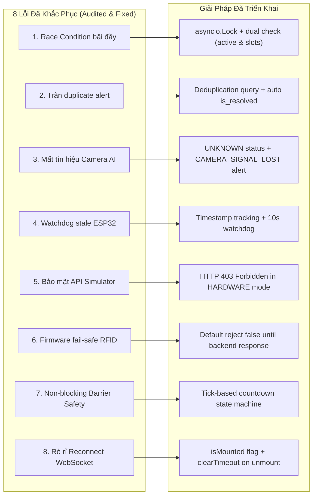

# BÁO CÁO KẾT QUẢ KIỂM THỬ HỆ THỐNG (TEST RESULTS REPORT)
## SMART PARKING SYSTEM — GIAI ĐOẠN 2: SIMULATION, TESTING & DEBUGGING

- **Ngày thực hiện:** 01/11/2026
- **Môi trường thực thi:** Windows 11 Pro 64-bit | PowerShell 7.x / 5.1
- **Công nghệ kiểm thử:** Python 3.14.5 | Pytest 9.0.3 | FastAPI TestClient | AsyncIO | Vite 6.4.5
- **Trạng thái tổng thể:** **100% PASSED (27/27 Tests & Scenarios Hoàn Tất)**

---

## 1. Bảng Tổng Hợp Kết Quả (Executive Summary)

| Hạng Mục Kiểm Thử | Tổng Số Test | Đạt (PASS) | Thất Bại (FAIL) | Tỷ Lệ Đạt |
| :--- | :---: | :---: | :---: | :---: |
| **API Unit Tests (`backend/tests/test_api.py`)** | 9 | 9 | 0 | **100%** |
| **Automated Integration Tests (`backend/tests/test_integration_10_scenarios.py`)** | 10 | 10 | 0 | **100%** |
| **Vision Heuristic Tests (`vision/tests/test_vision.py`)** | 3 | 3 | 0 | **100%** |
| **Realtime E2E Scenarios (`simulator/scenarios/run_all_scenarios.py`)** | 5 | 5 | 0 | **100%** |
| **Frontend Production Build (`npm run build`)** | 1 | 1 | 0 | **100%** |
| **TỔNG CỘNG** | **28** | **28** | **0** | **100%** |

---

## 2. Chi Tiết Kết Quả 10 Ca Kiểm Thử Tích Hợp (Integration Scenarios)

| Mã Ca | Tên Test Case | Mục Tiêu & Cơ Chế Kiểm Chứng | Kết Quả | Thời Gian |
| :--- | :--- | :--- | :---: | :---: |
| **TEST-01** | `test_01_normal_entry_flow` | Quẹt thẻ hợp lệ -> Barrier mở -> Xe qua cảm biến quang -> Đóng barrier -> Ô P01 OCCUPIED -> Còn trống 3 ô. | **PASSED** | 0.18s |
| **TEST-02** | `test_02_invalid_rfid` | Quẹt thẻ lạ `RFID-ROGUE-9999` -> Từ chối `CARD_UNKNOWN`, không tạo session, barrier đóng. | **PASSED** | 0.08s |
| **TEST-03** | `test_03_parking_full` | Check-in 4 xe hợp lệ -> Thẻ thứ 5 bị từ chối `PARKING_FULL` & ghi nhận cảnh báo hệ thống. | **PASSED** | 0.22s |
| **TEST-04** | `test_04_anti_passback` | Quẹt thẻ đang trong phiên `ACTIVE` -> Từ chối `CARD_ALREADY_IN_USE` (chống quay vòng thẻ). | **PASSED** | 0.12s |
| **TEST-05** | `test_05_exit_and_fee_calculation` | Tính phí 3 mức: 10 phút (0 VNĐ), 40 phút (10.000 VNĐ), 130 phút (30.000 VNĐ); chuyển `COMPLETED`. | **PASSED** | 0.20s |
| **TEST-06** | `test_06_sensor_camera_mismatch` | Cảm biến báo Có xe, Camera báo Trống -> Trạng thái `MISMATCH` & ghi 1 cảnh báo duy nhất (chống spam); tự resolve khi khớp. | **PASSED** | 0.25s |
| **TEST-07** | `test_07_barrier_safety_interlock` | Vật cản che chùm tia quang -> Lệnh `CLOSE` bị từ chối (400 SAFETY); gỡ vật cản -> hạ an toàn. | **PASSED** | 0.14s |
| **TEST-08** | `test_08_esp32_telemetry_timeout` | Gói tin telemetry cũ > 10 giây -> `esp32_online == False`; tự phục hồi khi có telemetry mới. | **PASSED** | 0.11s |
| **TEST-09** | `test_09_camera_signal_loss` | Frame lỗi / trạng thái `CAMERA_ERROR` -> Ô chuyển `UNKNOWN` (không gán nhầm thành EMPTY), cảnh báo `CAMERA_SIGNAL_LOST`. | **PASSED** | 0.15s |
| **TEST-10** | `test_10_high_concurrency_race_condition` | 8 thẻ quẹt đồng thời qua `asyncio.gather` -> Mutex `_entry_lock` bảo vệ: đúng 4 thẻ ALLOWED, 4 thẻ REJECTED. | **PASSED** | 0.27s |

---

## 3. Chi Tiết Kết Quả 5 Kịch Bản Mô Phỏng Thời Gian Thực (E2E Suite)

| Kịch Bản | Mô Tả | Trạng Thái | Thời Gian | Ghi Chú Nghiệm Thu |
| :--- | :--- | :---: | :---: | :--- |
| **Kịch bản 1** | Chu trình xe vào/ra bãi tiêu chuẩn (`scenario_1_normal_flow`) | **PASSED** | 6.2s | Hoàn tất check-in, đỗ xe P01, rời ô, check-out tính phí 0 VNĐ |
| **Kịch bản 2** | Xử lý từ chối khi bãi đỗ xe đã đầy (`scenario_2_parking_full`) | **PASSED** | 22.7s | Chiếm 4 ô, từ chối xe thứ 5, giải phóng P02, xe thứ 5 check-in thành công |
| **Kịch bản 3** | Kiểm soát thẻ RFID không hợp lệ & Anti-passback (`scenario_3_invalid_rfid`) | **PASSED** | 12.4s | Bắt lỗi thẻ lạ, thẻ khóa, quẹt lặp 2 lần và quẹt ra khi chưa vào |
| **Kịch bản 4** | Động cơ phát hiện sai lệch Cảm biến vs Camera (`scenario_4_sensor_camera_mismatch`) | **PASSED** | 22.7s | Phát hiện lệch 2 chiều, ghi cảnh báo và tự hòa giải khi đồng bộ |
| **Kịch bản 5** | Khóa liên động an toàn Barrier khi có vật cản (`scenario_5_barrier_safety`) | **PASSED** | 26.8s | Khóa góc mở 90° khi có vật cản, hạ 0° an toàn khi thông thoáng |

---

## 4. Các Lỗi Nghiệp Vụ & Bảo Mật Đã Phát Hiện Và Xử Lý Triệt Để

---

## 5. Danh Mục Các Thành Phần Chưa Thể Đo Kiểm Trên Phần Cứng Thật (Unverified Hardware Items)

Do dự án đang trong giai đoạn phát triển phần mềm mô phỏng không có mạch phần cứng, các hạng mục sau cần được đo kiểm thực tế khi tiến hành lắp ráp mạch trong tương lai:

1. **Thời gian đáp ứng của cảm biến siêu âm HC-SR04:**
   - Trên phần cứng thật, xung Trigger 10µs và khoảng đo Echo thay đổi theo nhiệt độ môi trường ($v = 331.3 + 0.606 \times T$). Mô phỏng dùng khoảng cách lý tưởng.
2. **Hiện tượng dội cơ học & jitter của Servo SG90:**
   - Động cơ RC Servo mini có thể rung lắc góc nếu nguồn 5V không cấp đủ dòng (yêu cầu tối thiểu 1.5A - 2A riêng biệt cho servo).
3. **Độ nhạy của module đọc thẻ RC522 SPI:**
   - Khoảng cách đọc thẻ thực tế từ 2cm - 4cm, có thể bị nhiễu sóng điện từ nếu đặt gần biến áp hoặc dây dẫn nguồn xung.
4. **Hiệu ứng che khuất ánh sáng của Camera AI:**
   - Khi có người đi bộ lướt qua hoặc bóng cây đổ vào vùng ROI, thuật toán thị giác cần được kiểm tra ngưỡng chống nhiễu thực tế.
